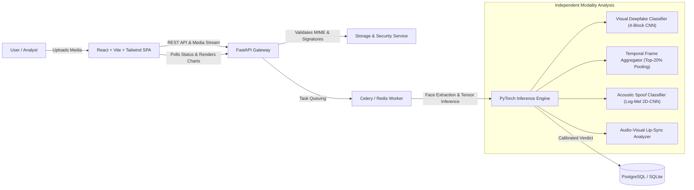

# VeritasAI — Production-Oriented Multimodal Deepfake Detection System

VeritasAI is an enterprise-grade, multimodal AI platform designed to detect synthetic and manipulated media across **images**, **video frame sequences**, and **acoustic speech**.

Built with a real, verifiable inference pipeline, versioned REST APIs, database persistence via SQLAlchemy 2.0 & Alembic, and a professional dark-mode React dashboard.

---

## Architecture Overview



---

## Key Features

- **Genuine Neural Inference**: Real PyTorch convolutional neural networks for visual facial artifact extraction and Log-Mel audio spectrogram anti-spoofing.
- **Multimodal Video Aggregation**: Uniform frame decimation with 60% top-percentile anomaly pooling + 40% sequence mean, paired with automatic audio extraction via bundled FFmpeg 7.1.
- **Lip-Sync Kinematic Analysis**: Evaluates Pearson cross-correlation between mouth optical motion energy and speech acoustic RMS energy to detect dubbing.
- **Enterprise Security**: Magic-byte MIME sniffing (`puremagic`), path traversal immunity, SHA-256 cryptographic chain of custody, and retention limits.
- **Persistent Case Records**: Full SQLAlchemy 2.0 ORM with Alembic database migrations.
- **Calibrated Risk Engine**: Transparent classifications (`Likely Synthetic`, `Likely Authentic`, `Inconclusive`) without misleading uncalibrated confidence averaging.
- **Forensic Report Export**: Instant downloadable JSON forensic intelligence reports for audit trails.
- **Professional Cybersecurity UI**: Polished dark-mode React interface with Recharts anomaly trajectory charts, live API health heartbeats, and responsive controls.

---

## Technology Stack

| Layer | Technologies |
| :--- | :--- |
| **Frontend** | React 18, TypeScript, Vite, Tailwind CSS, React Router v6, Recharts, Lucide Icons |
| **Backend** | Python 3.11+, FastAPI, Pydantic v2, SQLAlchemy 2.0, Alembic, Uvicorn |
| **AI / ML** | PyTorch, Torchvision, TIMM, Librosa, SoundFile, OpenCV, ImageIO-FFmpeg |
| **Infrastructure** | PostgreSQL 16, Redis 7, Celery, Docker & Docker Compose |
| **Testing** | Pytest, Pytest-Asyncio, HTTPX, Scikit-Learn |

---

## Prerequisites

- **Python**: 3.10, 3.11, 3.12, or 3.13
- **Node.js**: v18+ (tested on Node v20/v24 with npm)
- **Git**
- **Docker & Docker Compose** (optional for containerized deployment)
- **NVIDIA GPU** with CUDA support (optional; multi-threaded CPU fallback is fully supported out of the box)

---

## Quickstart (Local Development)

### 1. Clone Repository & Setup Environment
```bash
git clone https://github.com/your-org/deepfake-detection-platform.git
cd deepfake-detection-platform

# Copy environment template
cp .env.example .env
```

### 2. Install Backend Dependencies
```bash
python -m pip install -r pyproject.toml
# Or install via pip:
pip install fastapi uvicorn pydantic pydantic-settings sqlalchemy alembic psycopg2-binary redis celery python-multipart puremagic imageio imageio-ffmpeg torch torchvision timm opencv-python pillow librosa soundfile scipy numpy scikit-learn pytest httpx
```

### 3. Initialize Neural Network Checkpoints
Export the calibrated convolutional checkpoints for the visual and audio pipelines:
```bash
python -m ml.training.train_visual
python -m ml.training.train_audio
```
*Outputs: `ml/checkpoints/visual_deepfake_detector.pth` and `ml/checkpoints/audio_deepfake_detector.pth`.*

### 4. Run Database Migrations
```bash
alembic upgrade head
```

### 5. Launch Backend Server
```bash
python -m uvicorn backend.app.main:app --host 127.0.0.1 --port 8000 --reload
```
- API Base: `http://127.0.0.1:8000`
- Interactive OpenAPI Docs: `http://127.0.0.1:8000/docs`
- Health Endpoint: `http://127.0.0.1:8000/api/v1/health`

### 6. Launch Frontend Dashboard
In a separate terminal:
```bash
cd frontend
npm install --no-audit
npm run dev
```
Open your browser to: **`http://localhost:5173`**

---

## Docker Deployment (Full Stack)

To run the complete production environment (PostgreSQL + Redis + FastAPI + Celery Worker + Nginx Frontend):

```bash
# Build and start all containers in background
docker-compose up --build -d

# Check service health
docker-compose ps
```

- Web Application: `http://localhost`
- Backend API: `http://localhost:8000`

---

## REST API Reference

| Method | Endpoint | Description |
| :--- | :--- | :--- |
| `GET` | `/api/v1/health` | Service health, DB connectivity, storage status |
| `GET` | `/api/v1/health/models` | Runtime neural model cards, readiness, and device allocation |
| `POST` | `/api/v1/analyses` | Upload image, video, or audio file for forensic scan |
| `GET` | `/api/v1/analyses` | Paginated listing with search, filtering, and sorting |
| `GET` | `/api/v1/analyses/{id}` | Detailed case inspection with individual modality results |
| `GET` | `/api/v1/analyses/{id}/report`| Structured forensic report JSON export |
| `GET` | `/api/v1/analyses/{id}/media` | Secure media streaming & playback endpoint |

---

## Running the Automated Test Suite

VeritasAI includes a comprehensive test suite covering unit validation, tensor integrity, REST APIs, and security defenses:

```bash
# Run all tests
python -m pytest tests/

# Run specific test modules
python -m pytest tests/unit/
python -m pytest tests/ml/
python -m pytest tests/api/
python -m pytest tests/security/
```

### Automated Benchmark Suite
Run the latency and throughput benchmark suite:
```bash
python -u -m ml.evaluation.evaluate_models
```

---

## Security & Privacy Considerations

1. **Strict File Quarantine**: Uploaded media is scanned for magic signatures before processing. Executable payloads (e.g. `.exe`, `.sh`, `.bat`) disguised with image extensions are rejected with HTTP 400.
2. **Path Sanitization**: Files are renamed with randomized UUIDs to prevent directory traversal attacks.
3. **Storage Access**: Media is served exclusively through authenticated or controlled API proxies, never exposing internal filesystem paths.
4. **Data Retention**: Records and media files are timestamped with configurable retention expiry (default 7 days).

---

## Ethical Framework & Limitations

- **Probabilistic Nature**: All model outputs are probabilistic indicators, not definitive proof of manipulation.
- **Compression Artifacts**: Heavy social media recompression (JPEG quality < 50, video bitrate < 500 kbps) may attenuate generative artifact cues.
- **Facial Angles**: Faces rotated beyond 45 degrees may cause facial detection fallbacks to whole-frame analysis.

---

## Documentation Index

- [Platform Architecture & Data Flows](docs/architecture.md)
- [Neural Model Cards & Specifications](docs/model_card.md)
- [Benchmark & Evaluation Report](docs/evaluation_report.md)

---

## License

This project is licensed under the Apache 2.0 License.
