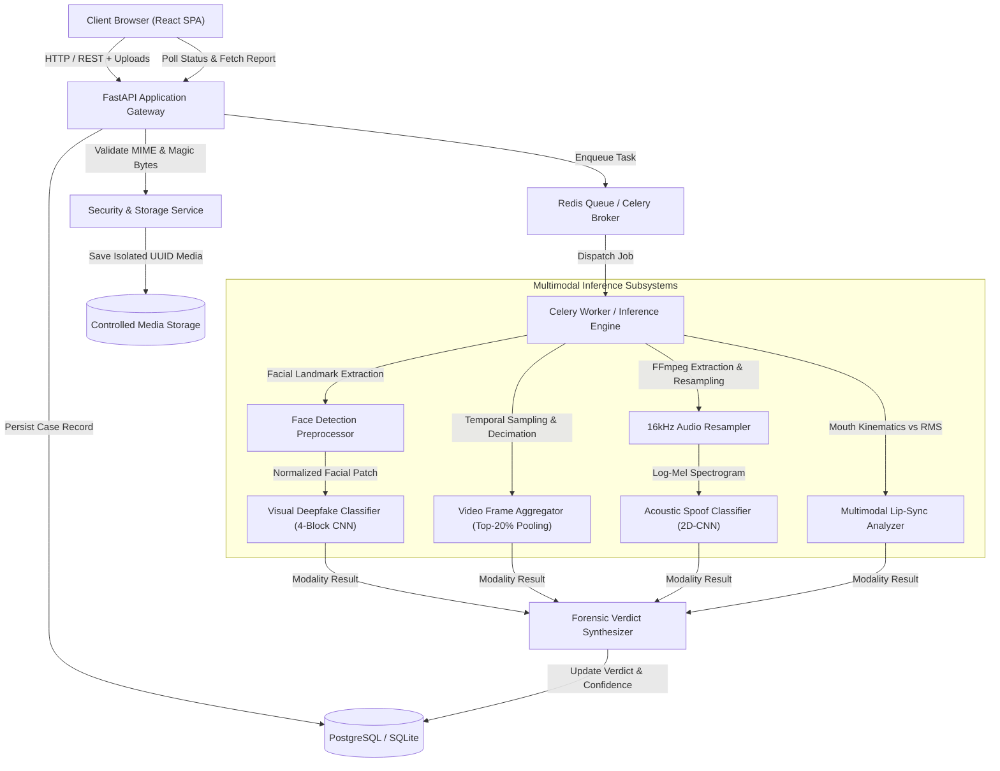

# VeritasAI Platform Architecture & System Design

## 1. High-Level Architecture Overview

VeritasAI is engineered as an enterprise-grade, multimodal deepfake detection system with independent inference pathways for visual imagery, temporal video sequences, and acoustic speech synthesis.

---

## 2. Component Design

### A. Frontend Layer (React + TypeScript + Vite)
- **State Management & Routing**: React Router v6 with modular page components.
- **Visual Aesthetic**: Cybersecurity dark-mode interface with electric-blue accents, accessible contrast ratios, and responsive layouts.
- **Visualizations**: Recharts for temporal frame anomaly trajectories and audio chunk spectrogram tracking.
- **Resilience**: Real-time polling with graceful backoff, upload progress monitoring, and deterministic error boundaries.

### B. API Gateway & Security Perimeter (FastAPI)
- **File Validation**: Multi-layer inspection combining file extension whitelisting, MIME type sniff testing, and magic byte file signature validation (`puremagic`).
- **Path Traversal Defense**: All uploaded files are immediately assigned a randomized UUIDv4 server-side filename, stripping directory traversal characters (`..`, `/`, `\`).
- **Resource Limits**: Strict constraints on file size (50MB), video duration (120s), and audio duration (300s).

### C. Persistent Storage Layer (SQLAlchemy 2.0 + Alembic)
- **Tables**:
  - `analyses`: Master record with original filename, SHA-256 hash, media type, status, overall verdict, risk level, and retention expiry.
  - `modality_results`: Detailed modality records (visual, audio, sync) with raw logits, confidence scores, artifact metadata, and execution time.
  - `model_versions`: Auditable tracking of loaded checkpoints and architectures.

### D. Asynchronous Worker & Queue (Celery + Redis)
- Decouples long-running video frame decoding and neural tensor evaluation from the HTTP request-response cycle.
- Graceful standalone fallback: Operates in `CELERY_ALWAYS_EAGER=true` mode using FastAPI BackgroundTasks for zero-dependency local development.

---

## 3. Multimodal Analysis Pipelines

### 1. Visual Image Pipeline
1. Decodes image safely using OpenCV / Pillow.
2. OpenCV Haar Cascade isolates the primary facial boundary and adds a 20% proportional margin.
3. Resizes to 224x224 and normalizes using standard ImageNet parameters.
4. Evaluates tensor via `VisualDeepfakeClassifier`, producing Softmax probabilities `[P(Authentic), P(Synthetic)]`.

### 2. Video Temporal Pipeline
1. Decodes container metadata (FPS, total frames, duration).
2. Uniformly decimates up to 32 representative frames across the video timeline, preventing high-resolution memory buffering.
3. Evaluates eligible frames with facial extraction and visual classifier.
4. Aggregates frame scores: 60% top-20% anomaly pooling + 40% sequence mean.
5. Extracts audio track via bundled FFmpeg 7.1 to evaluate audio speech synthesis simultaneously.

### 3. Audio Anti-Spoofing Pipeline
1. Decodes audio and resamples to 16,000 Hz mono.
2. Segments into 3.0s windows and computes 128-bin Log-Mel Spectrograms.
3. Evaluates acoustic tensors via `AudioDeepfakeClassifier`.
4. Computes physical acoustic indicators: spectral flatness, spectral centroid, and spectral rolloff.

### 4. Audio-Visual Lip-Sync Pipeline
1. Tracks mouth optical motion energy over sampled video frames.
2. Computes simultaneous speech acoustic RMS energy envelope.
3. Evaluates Pearson correlation; correlation below threshold indicates dubbing or synthetic audio mismatch.
